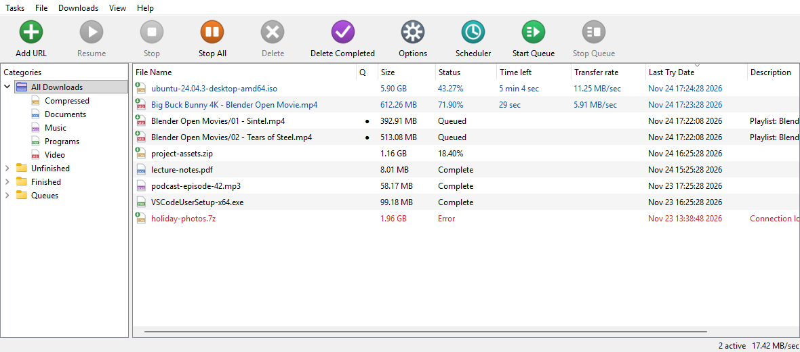
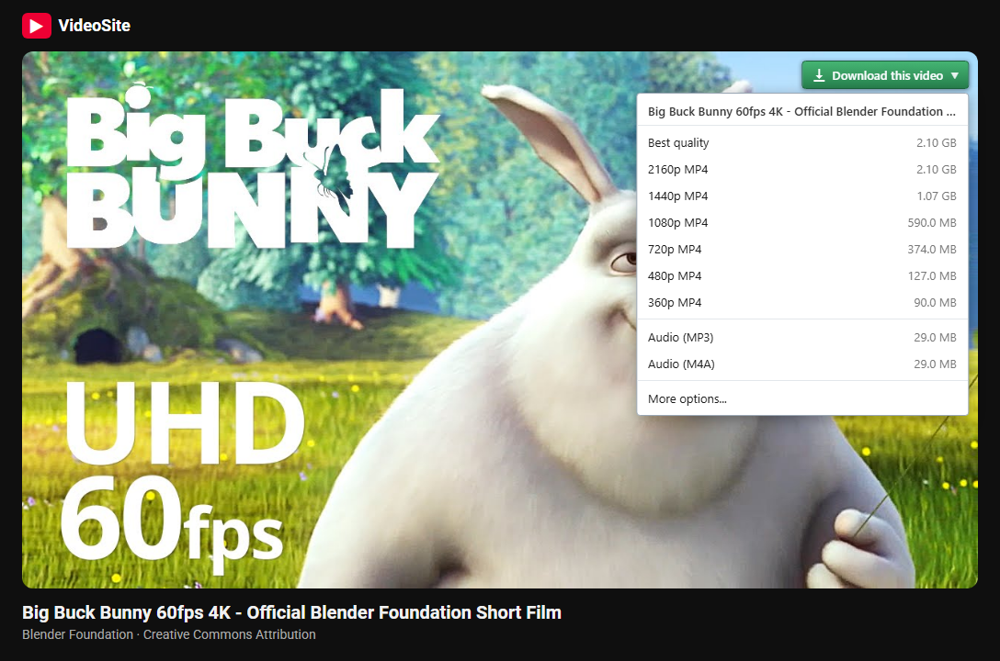
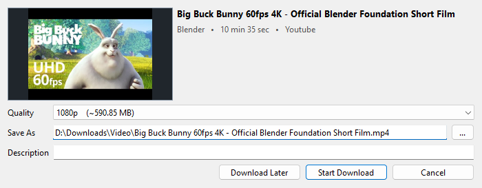
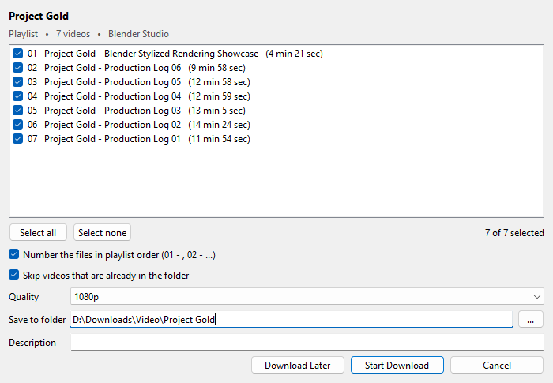
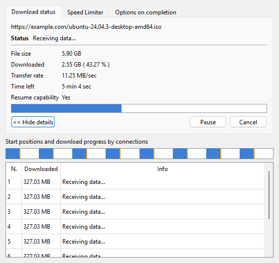
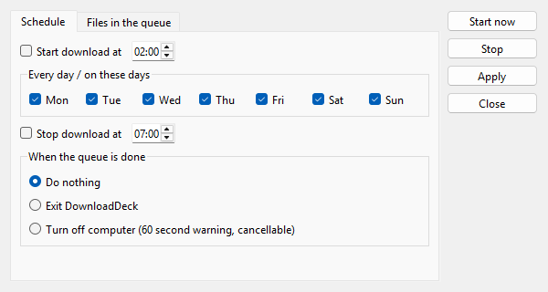
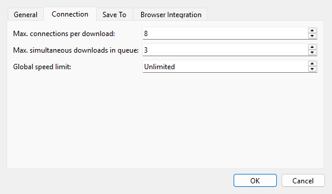

# DownloadDeck

A fast, multi-connection download manager for Windows. It splits every file across up to 32 connections, resumes after crashes or reboots, and catches downloads straight from your browser. It also downloads videos and whole playlists from YouTube and other sites in the quality you pick.



**[⬇ Download the latest version](../../releases/latest)**, then follow the [installation guide](#installation).

---

## Features

**Faster downloads**
- Splits each file into up to 32 parallel connections (default 8). When one connection finishes its part, it takes over half of the biggest part still left, so all connections stay busy to the end.
- Pause and resume at any time, even after closing the app or restarting the PC.
- Retries dropped connections automatically. If a server limits how many connections you can open, the extra ones close and the rest carry on.

**Video downloads, one click from the page**

Hover over any video and a green **Download this video ▼** button appears. Click it to see every quality with its file size. Pick one and the download starts.



- Qualities from 144p to 4K, or audio only as MP3 / M4A.
- Video and audio are joined into one MP4 that plays everywhere.
- Works on YouTube, Vimeo, Facebook, Instagram, X, TikTok, Reddit, Twitch, SoundCloud and many more sites.

**Whole playlists**
- Open a playlist, or a video that's part of one, to see every video in it with tick boxes.
- Picked videos join the download queue as numbered files: `01 - title.mp4`, `02 - …`
- Running the same playlist again skips the videos you already have, so you only get the new ones.

| Video window | Playlist window |
|---|---|
|  |  |

**See every connection**



**Organized and scheduled**
- Files sort into categories (Compressed, Documents, Music, Programs, Video), each with its own folder if you want.
- **Download Later** adds a file to the queue, which downloads a set number of files at a time.
- The scheduler can start and stop the queue at set times and days. When the queue finishes, it can exit the app or turn off the PC, with a 60-second warning you can cancel.
- Speed limiter for all downloads, or per download.
- Clipboard watching: copy a download or video link and DownloadDeck offers to grab it.
- Waits in the system tray and can start with Windows.

| Scheduler | Options |
|---|---|
|  |  |

---

## Installation

**Requires:** Windows 10 or 11 (64-bit), plus Chrome, Edge or Brave for browser integration.

### 1. Install the app

1. Download **`DownloadDeck-…-win64.zip`** from the [latest release](../../releases/latest).
2. Right-click the zip, choose **Extract All…**, and extract it somewhere permanent, for example `C:\Apps\DownloadDeck`.
   Don't run it from inside the zip, and don't move the folder later.
3. Open the folder and double-click **`DownloadDeck.exe`**.
   - If Windows shows **"Windows protected your PC"**, click **More info → Run anyway**. This appears because the app isn't code-signed.
4. On first start, DownloadDeck asks whether to create a desktop shortcut and start with Windows. Click **Yes**.

### 2. Add the browser extension

This adds the video button and sends browser downloads to DownloadDeck.

1. In Chrome, open `chrome://extensions`. In Edge, open `edge://extensions`.
2. Turn on **Developer mode** (switch at the top-right).
3. Click **Load unpacked** and choose the **`chrome-extension`** folder inside your DownloadDeck folder.
4. Click the puzzle icon 🧩 in the toolbar and pin **DownloadDeck Integration** 📌.
5. Refresh any tabs that were already open.

That's it. Hover over a video to see the download button. Files you download in the browser now go to DownloadDeck. If DownloadDeck is closed, the extension starts it.

> The browser connects to DownloadDeck through native messaging, the standard way desktop apps and extensions talk to each other. DownloadDeck registers this for your Windows user every time it starts. Nothing is installed system-wide, and no admin rights are needed.

### Uninstall

1. Remove **DownloadDeck Integration** on `chrome://extensions`.
2. Right-click the tray icon and choose **Exit**.
3. Delete the DownloadDeck folder, the desktop shortcut, and `DownloadDeck.lnk` in your Startup folder (`Win + R` → `shell:startup`).
4. Optional: delete your settings and download list in `%APPDATA%\DownloadDeck` and `%LOCALAPPDATA%\DownloadDeck`.

---

## Troubleshooting

| Problem | Fix |
|---|---|
| No green button on videos | Make sure the extension is enabled on `chrome://extensions`, then refresh the page. |
| Button says "DownloadDeck not reachable" | Start DownloadDeck once, wait 15 seconds, then try again. DownloadDeck registers the browser connection when it runs. |
| Extension gone after restarting Chrome | Keep Developer mode on, and don't move or rename the DownloadDeck folder. Load the extension again if needed. |
| YouTube videos fail | YouTube changes often. Download the [latest release](../../releases/latest), which bundles the newest yt-dlp. |
| Logs | `%APPDATA%\DownloadDeck\bridge.log` |

---

## Building from source

You need Python 3.12+ on Windows.

```powershell
git clone <this repository>
cd DownloadDeck
python -m venv .venv
.venv\Scripts\python.exe -m pip install -r requirements.txt
.venv\Scripts\python.exe app.py
```

To build the shareable zip (it lands in `release\`):

```powershell
powershell -ExecutionPolicy Bypass -File build.ps1
```

**Project layout**

| File | What it does |
|---|---|
| `engine.py` | Multi-connection download engine, queue, persistence (no GUI) |
| `video.py` | Video sites through yt-dlp (qualities, playlists, merging) |
| `app.py` | Main window, tray, scheduler, clipboard, local bridge server |
| `dialogs.py` | All dialogs (add URL, file info, progress, video/playlist, options, scheduler) |
| `native_host.py` / `native_reg.py` | Browser ↔ app bridge (native messaging) and its registration |
| `chrome-extension/` | Browser extension: download capture and the in-page video button |
| `tools/` | Scripts that render the README screenshots |

---

## Please download responsibly

Only download content you have the right to download: your own uploads, Creative Commons or public-domain works, or content whose owner allows it. Downloading videos may be against a site's terms of service. You are responsible for how you use this tool.

## License

DownloadDeck is released under the [MIT License](LICENSE). Bundled third-party components keep their own licenses; see [THIRD-PARTY-NOTICES.md](THIRD-PARTY-NOTICES.md).
